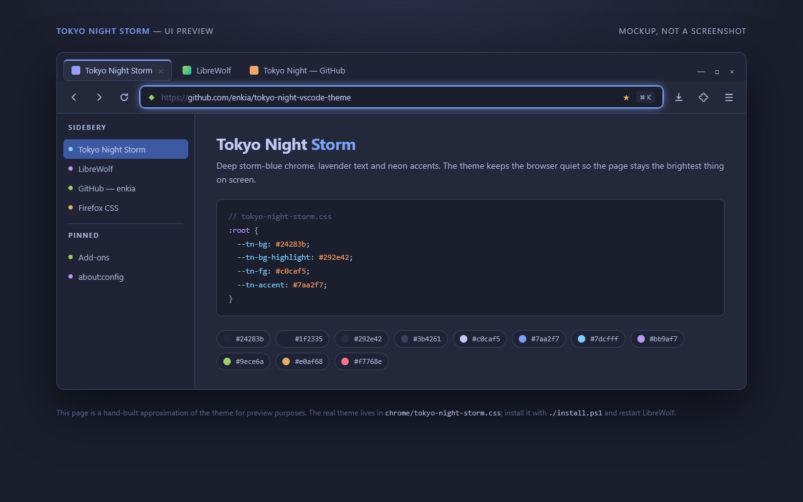

# Tokyo Night Storm for LibreWolf / Firefox

A Tokyo Night Storm theme for the browser chrome: storm-blue surfaces, lavender
text, neon-blue accents, and a dark treatment for Firefox/LibreWolf's internal
pages.



Targets **LibreWolf 160 / Firefox 160** with the Nova UI (157+). The CSS
includes pre-Nova fallbacks for the main surfaces, so it still works if Nova is
switched off.

## What it styles

- Window frame, tab strip, toolbars, bookmarks bar
- Tabs (selected, hover, vertical, tab groups) and close buttons
- Address bar, focused/open state, results dropdown, identity/page actions
- Menus, panels, downloads, extension popups, tooltips
- Sidebar (Nova and classic), find bar, notification bars, status panel
- Window controls (Windows/Linux titlebar buttons)
- Private windows get a Tokyo Night magenta accent
- `about:` pages: new tab, Settings, Add-ons, `about:config`, Downloads,
  private browsing

## Palette

| Token | Hex | Used for |
| --- | --- | --- |
| `--tn-bg` | `#24283b` | toolbars, page background |
| `--tn-bg-dark` | `#1f2335` | frame, sidebar, panels |
| `--tn-bg-darker` | `#1b1e2d` | address bar, inputs |
| `--tn-bg-highlight` | `#292e42` | hover / selected surfaces |
| `--tn-border` | `#3b4261` | borders and separators |
| `--tn-fg` | `#c0caf5` | primary text |
| `--tn-fg-dark` | `#a9b1d6` | secondary text, inactive tabs |
| `--tn-comment` | `#565f89` | placeholders, disabled text |
| `--tn-blue` | `#7aa2f7` | accent, focus, selected tab rail |
| `--tn-blue0` | `#3d59a1` | selection / active background |
| `--tn-cyan` | `#7dcfff` | URLs, links, hover accent |
| `--tn-magenta` | `#bb9af7` | private browsing accent |
| `--tn-yellow` | `#e0af68` | bookmarked star |
| `--tn-red` | `#f7768e` | close-button hover |

## Install

### Requirements

1. LibreWolf 157+ (Nova UI on, which is the default).
2. In `about:config`, make sure this is `true`:

   ```
   toolkit.legacyUserProfileCustomizations.stylesheets
   ```

3. Know where your profile is. Easiest: open `about:profiles`, find the profile
   marked **Default**, and click **Open Folder** under **Root Directory**.
   On Windows it is usually:

   ```
   %APPDATA%\librewolf\Profiles\<random>.default-release
   ```

### Option A — installer script (recommended)

The script copies the theme files into your profile's `chrome` folder and adds
the `@import` lines to the top of your existing `userChrome.css` and
`userContent.css`. It backs up any file it modifies.

```powershell
# from this folder
.\install.ps1 -DryRun     # preview
.\install.ps1             # install
```

If PowerShell refuses to run the script, use:

```powershell
powershell -ExecutionPolicy Bypass -File .\install.ps1 -DryRun
powershell -ExecutionPolicy Bypass -File .\install.ps1
```

If you have more than one profile, pass one explicitly:

```powershell
.\install.ps1 -ProfilePath "$env:APPDATA\librewolf\Profiles\8tlxbvgs.default-release"
```

Then restart LibreWolf.

### Option B — manual, keeping your existing customisations

Your current `userChrome.css` is **not** replaced. Put the two theme files next
to it:

```
<profile>\
  chrome\
    userChrome.css                 <- your existing file
    userContent.css                <- optional, your existing file
    tokyo-night-storm.css          <- copy from this repo's chrome\
    tokyo-night-storm-content.css  <- copy from this repo's chrome\
```

Then add these as the **first line** of `userChrome.css`:

```css
@import url("tokyo-night-storm.css");
```

and, if you use `userContent.css`, the first line of that file:

```css
@import url("tokyo-night-storm-content.css");
```

Only `@charset` may appear before an `@import`. Restart the browser afterward.

### Option C — fresh profile

Copy this repo's `chrome` folder into your profile root, replacing the `chrome`
folder only if you do not already have customisations there. The included
`chrome/userChrome.css` and `chrome/userContent.css` are just the import lines.

### Optional — installable theme add-on

The `theme` folder is a standard static theme. It paints the frame, toolbar,
sidebar, URL bar, menus and new-tab page with the same palette. It is optional:
`userChrome.css` already covers the chrome, and `userContent.css` covers the new
tab page.

```powershell
.\build.ps1
# -> dist\tokyo-night-storm.xpi
```

Install it:

1. `about:config` → `xpinstall.signatures.required` → `false`
   (LibreWolf accepts unsigned add-ons; Firefox Release does not).
2. `about:addons` → gear icon → **Install Add-on From File…** → pick the XPI.

Or load `theme/manifest.json` temporarily via `about:debugging` → **This
LibreWolf** → **Load Temporary Add-on**.

Using the add-on and the CSS together is fine; the CSS wins where they overlap.

## Customising

The whole theme derives from the variables at the top of
`chrome/tokyo-night-storm.css`. Append overrides to the bottom of that file (or
to your own CSS after the import) instead of editing rules throughout.

```css
/* Different accent */
:root {
  --tn-accent: var(--tn-magenta);
  --tn-accent-soft: #4a3a6b;
}

/* Squarer UI */
:root {
  --tn-radius: 4px;
  --tn-tab-radius: 4px;
}

/* Larger address-bar text */
#urlbar-input { font-size: 1.05em !important; }
```

## Notes

- **Existing customisations:** the theme never changes tab-strip visibility or
  toolbar layout. A `userChrome.css` that hides the horizontal tab strip (for
  example to use Sidebery) and moves the window controls keeps working; the
  theme only colours those elements.
- **Nova:** built for the Nova UI. If you turn Nova off in LibreWolf's
  Appearance settings, the legacy tokens included in the theme keep the main
  surfaces and address bar themed, but Nova-only details (sidebar layout, tab
  group styling, some radii) will differ.
- **LibreWolf's own theme:** LibreWolf ships with a dark theme. The theme is
  independent of it; you can keep **Dark** selected in Appearance.
- **Sidebery / other sidebar extensions:** they draw their own content. The
  browser sidebar frame is themed, but for the panel itself use the extension's
  own theme settings with the palette above.
- **Private windows** switch the accent from blue to magenta automatically.
- **`userContent.css`** affects internal `about:` pages only. Website scrollbar
  and selection snippets are included but commented out at the bottom of
  `tokyo-night-storm-content.css`.
- **Reset:** remove the `@import` line(s), or restore the `.bak-*` files created
  by the installer.

## Files

```
chrome/
  userChrome.css                  entry point (@import)
  userContent.css                 entry point (@import)
  tokyo-night-storm.css           browser chrome theme
  tokyo-night-storm-content.css   about: pages / new tab
theme/
  manifest.json                   optional static theme add-on
  icon.svg
install.ps1                       safe installer for LibreWolf profiles
build.ps1                         builds dist/tokyo-night-storm.xpi
preview.html                      hand-built UI mockup
preview.png                       screenshot of the mockup
```

## Credits

- Palette: [Tokyo Night](https://github.com/enkia/tokyo-night-vscode-theme) by
  enkia (MIT).
- Built against Firefox/LibreWolf's Nova UI and the theme/token names documented
  by Mozilla.

## License

MIT — see [LICENSE](LICENSE).
